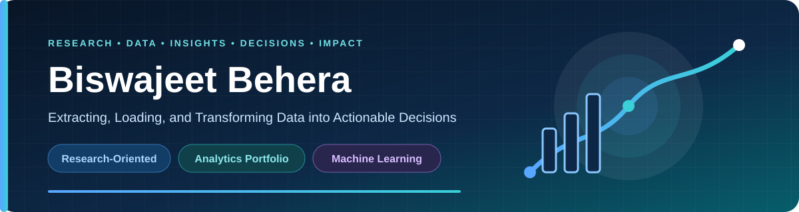

  
  
  

## Profile overview

I am an **M.Tech student and aspiring data scientist** who enjoys turning complex datasets into clear business decisions. My work combines exploratory analysis, KPI design, visual storytelling, and machine-learning prediction across supply chain, healthcare, retail, HR, and sales domains.

<table>
  <tr>
    <td align="center" width="25%">
      <h2>13</h2>
      <strong>Public Repositories</strong> 
    </td>
    <td align="center" width="25%">
      <h2>5</h2>
      <strong>Business Domains</strong> 
    </td>
    <td align="center" width="25%">
      <h2>Python</h2>
      <strong>Primary Language</strong> 
    </td>
    <td align="center" width="25%">
      <h2>M.Tech</h2>
      <strong>Current Journey</strong> 
    </td>
  </tr>
</table>

### Analytics workflow

| 01 — Prepare | 02 — Explore | 03 — Visualize | 04 — Predict |
|:---:|:---:|:---:|:---:|
| Clean and validate data | Discover KPIs and patterns | Communicate business evidence | Recommend practical action |

## Featured case study

### 🚚 [Supply Chain Delivery Performance Analysis](https://github.com/biswajeet-gitcom/supply_chain_logistic)

An end-to-end supply-chain study covering data cleaning, exploratory analysis, business KPIs, profitability, operational bottlenecks, time-based trends, and late-delivery prediction.

| Source records | Cleaned orders | Net order profit | Late deliveries |
|---:|---:|---:|---:|
| **180,519** | **176,827** | **$3.89M** | **57.28%** |

`Python` · `Pandas` · `Numpy` · `Matplotlib` · `Seaborn` · `Scikit-learn` · `SMOTE` · `XGBoost` · `Jupyter Notebook`

## Selected analytics portfolio

| Project | Business focus | Main tools |
|---|---|---|
| [🛒 Walmart Sales Analysis](https://github.com/biswajeet-gitcom/Walmart_sales_data_analysis) | Store-level sales patterns and business insights | Data Analysis, SQL + Power BI |
| [🫁 Lung Cancer Analysis](https://github.com/biswajeet-gitcom/lung_cancer_analysis) | Healthcare analysis and cancer-risk prediction | Python, Jupyter, Machine Learning |
| [📊 Superstore Sales Analysis](https://github.com/biswajeet-gitcom/Superstore_sales_analysis_Power-BI) | Retail sales performance and KPI reporting | Power BI |
| [🍽️ Restaurant Data Analysis](https://github.com/biswajeet-gitcom/Restaurant-data-analysis) | Restaurant sales analysis and reporting | Power BI, Excel |
| [👥 HR Analysis Report](https://github.com/biswajeet-gitcom/HR-Analysis-Report) | Employee attrition trends and workforce insights | Business Intelligence |

## Technical toolkit

**Data analysis and machine learning**

**Visualization and business intelligence**

**Applications and development**

## Let's connect

I am continuously learning and building practical analytics projects. Explore my work, share feedback, or connect with me to discuss data science, business intelligence, and machine learning.

  <a href="https://biswajeet.pages.dev">Portfolio</a> ·
  <a href="https://www.linkedin.com/in/biswajeet-in">LinkedIn</a> ·
  <a href="https://github.com/biswajeet-gitcom?tab=repositories">All Repositories</a>

<strong>Turning complex data into clear decisions.</strong>

